# 🏠 House Price Prediction Model

**A regression pipeline that prices King County (Seattle area) homes from their size, quality, age and location. It compares Linear, Multiple Linear, Lasso, Ridge and Gradient Boosting models on 21,613 real sales, and an interactive app returns a price estimate for any house.**


[](https://colab.research.google.com/github/aish-19shanbhag/house-price-prediction-model/blob/main/notebooks/house_price_walkthrough.ipynb)

| | |
|---|---|
| **Problem** | Estimate a home's sale price from its attributes and location |
| **Data** | King County, WA house sales, May 2014 to May 2015: 21,613 sales, 19 raw attributes, 70 zipcodes |
| **Approach** | Phase 1 reproduces the original 2020 course comparison. Phase 2 rebuilds it with leakage-free sklearn Pipelines, a log-price target, engineered location and age features, 5-fold CV and an untouched hold-out set |
| **Result** | Phase 1: **Lasso Regression wins** (test R² 0.692, 5-fold CV R² 0.674). Phase 2: **Gradient Boosting reaches R² 0.915** with RMSE **$113,376**, **17.1% lower** than the best linear model (Lasso, R² 0.876) |
| **Role** | 4-person PES University team, Aug 2020 to Dec 2020. I built the Multiple Linear Regression model, worked on model evaluation and wrote the conclusion. Rebuilt in 2026 as a reproducible, tested pipeline |

---

## Highlights

- **Faithful reproduction first.** The 2020 notebook no longer ran end to end, so Phase 1 rebuilds its comparison exactly as specified (same features, same alphas, same split). It confirms the original conclusion: **Lasso Regression had the lowest test RMSE ($198,682) and the highest test R² (0.692) and CV R² (0.674)** of the models compared.
- **A full 2026 upgrade.** With 22 model inputs (engineered from the raw columns), a log-price target and proper validation, every model improves sharply. Lasso goes from R² 0.692 to **0.876**, and Gradient Boosting reaches **0.915**.
- **Honest model selection.** The deployed model is the one with the lowest **5-fold CV RMSE** on the training split, chosen before the hold-out set was scored.
- **Location is the story.** Distance to downtown Seattle, zipcode, latitude and longitude are among the strongest signals in both the Lasso coefficients and the boosted model's permutation importance. The geospatial heat maps show why.
- **Usable.** A Streamlit app prices any house from its attributes and shows a typical error band. There are 10 automated tests (including a headless test of the app) and a one-click Colab notebook.

## ✨ Key features

| | Feature | What it does |
|---|---|---|
| 🔁 | **Original comparison, reproduced** | `src/original_comparison.py` rebuilds the 2020 four-model comparison exactly as the notebook specified it |
| 🧮 | **Multi-model regression** | Simple Linear, Multiple Linear, Lasso (alpha by CV), Ridge (alpha by CV), Gradient Boosting, HistGradientBoosting, XGBoost |
| 🏗️ | **Feature engineering** | House age, renovated flag, years since renovation, living/lot ratio, basement share, log square footage, haversine distance to downtown Seattle, sale year and month |
| 📍 | **Zipcode handled properly** | One-hot encoding for linear models, cross-fitted target encoding for tree models, both fitted inside every CV fold |
| 🛡️ | **Leakage-free pipelines** | Every learned step (scaling, encoding, alpha search) is part of one sklearn Pipeline, so CV and the hold-out set never leak into training |
| 📉 | **Log-price target** | `TransformedTargetRegressor` learns log(price) but reports every metric in dollars |
| 📊 | **Thorough evaluation** | RMSE, MAE, R², adjusted R², median % error, share of homes within 10%, and 5-fold CV mean ± std |
| 🗺️ | **Geospatial analysis** | Static hexbin heat maps of price and price per sq ft, plus an interactive Folium map |
| 🔎 | **Interpretability** | Lasso coefficients and permutation importance |
| 🖥️ | **Interactive demo** | A Streamlit app that prices a house from its attributes |
| ✅ | **Reproducible and tested** | Fixed seeds, saved metrics, pytest suite, Colab notebook |

## Why it matters

Price is the single number buyers, sellers, lenders and appraisers all argue about. A model that is accurate *and* explainable helps all of them. The explanation matters as much as the error: "this house is priced 10% above its zipcode median because of its grade and size" is something a person can check. That is why this project keeps the interpretable linear models alongside the more accurate boosted trees.

---

## Architecture

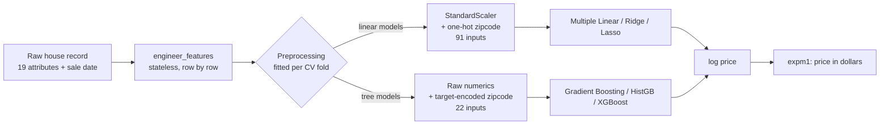

## Phase 1 vs Phase 2

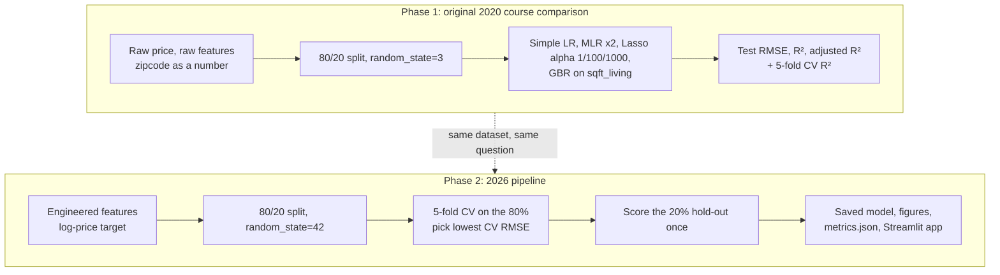

## Training and evaluation workflow

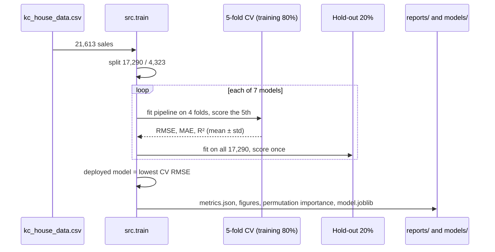

---

## Dataset

The [King County house sales dataset](https://www.kaggle.com/datasets/harlfoxem/housesalesprediction) covers 21,613 homes sold between May 2014 and May 2015 in King County, Washington, which includes Seattle, Bellevue and Redmond. It has no missing values. Prices range from $75,000 to $7.7 million (median $450,000), so the target is heavily right-skewed. That is the main reason Phase 2 models log(price).

| Group | Columns |
|---|---|
| Size | `sqft_living`, `sqft_above`, `sqft_basement`, `sqft_lot`, `bedrooms`, `bathrooms`, `floors` |
| Quality | `grade` (King County construction grade, 1 to 13), `condition` (1 to 5), `view` (0 to 4), `waterfront` |
| Age | `yr_built`, `yr_renovated` (0 if never renovated) |
| Location | `zipcode` (70 values), `lat`, `long` |
| Neighbourhood | `sqft_living15`, `sqft_lot15` (average of the 15 nearest homes) |
| Target | `price` |

<p align="center">
  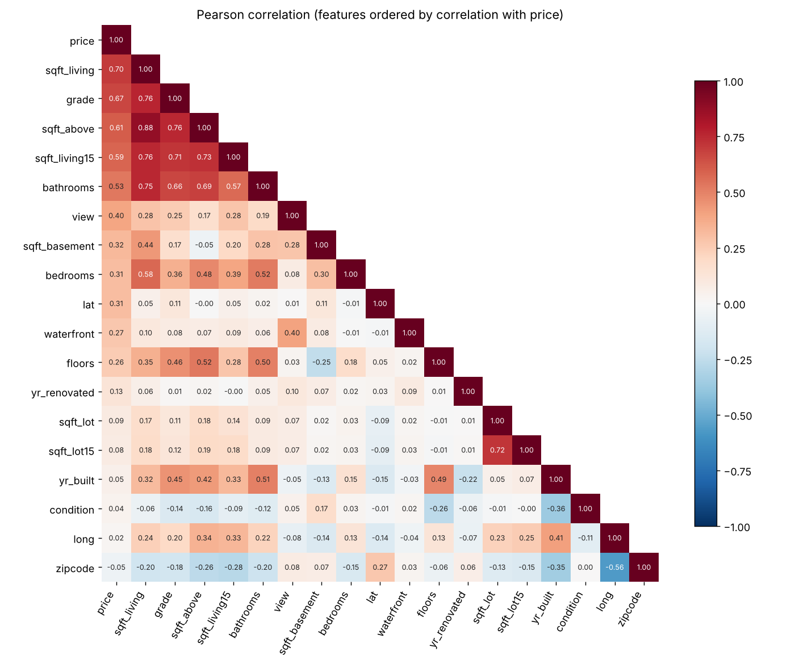
</p>

`sqft_living` (r = 0.70), `grade` (0.67), `sqft_above` (0.61) and `sqft_living15` (0.59) correlate most with price. `zipcode` *as a number* barely correlates (−0.05), even though location matters enormously. That's a sign the original models were using it wrongly, and Phase 2 fixes it.

### Where the expensive homes are

<p align="center">
  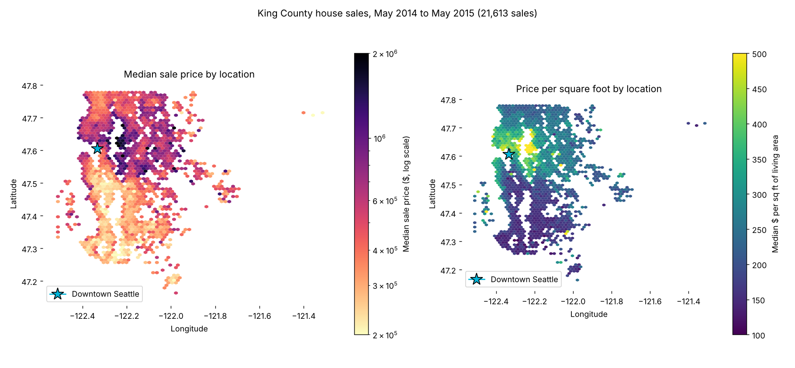
</p>

The highest prices cluster on the Eastside (Medina, Bellevue, Mercer Island) and in north-central Seattle. The south of the county is far cheaper per square foot. An interactive version, with zipcode medians and a heat layer of the top 10% of sales, is in [`reports/figures/price_map.html`](reports/figures/price_map.html). Download it and open it in a browser.

---

## Methodology

### Phase 1: the original course comparison, reproduced (`src/original_comparison.py`)

The 2020 notebook had several problems: undefined variables (`metrics`, `evaluation`, `df_train`), a Gradient Boosting row that recorded another model's scores, and cells that only worked if run out of order. Phase 1 rebuilds each model **exactly as specified**, without changing it:

| Model | Inputs | Settings |
|---|---|---|
| Simple Linear Regression | `sqft_living` | ordinary least squares |
| Multiple Linear Regression-1 | bedrooms, bathrooms, sqft_living, sqft_lot, floors, zipcode | ordinary least squares |
| Multiple Linear Regression-2 | the 6 above + view, grade, sqft_living15, sqft_lot15 | ordinary least squares |
| Lasso Regression | 16 raw features (all except dates and year columns) | alpha = 1, 100, 1000; scikit-learn defaults |
| Gradient Boosting | `sqft_living` only | 400 trees, depth 5, learning rate 0.1 |

The protocol is the same as the notebook's: raw price, raw unscaled features, `train_test_split(train_size=0.8, random_state=3)`, and `cross_val_score(cv=5)` on the full dataset. As in the notebook, the evaluation table is ranked by 5-fold CV R². Adjusted R² uses the standard formula 1 − (1 − R²)(n − 1)/(n − p − 1).

### Phase 2: the 2026 pipeline (`src/features.py`, `src/models.py`, `src/train.py`)

**1. Feature engineering.** These features are computed per row, so there is no leakage.

| Feature | Definition | Why |
|---|---|---|
| `house_age` | sale year − `yr_built` | Older homes sell differently |
| `is_renovated`, `years_since_renovation` | from `yr_renovated` (falls back to `yr_built`) | "Age since last major work" is more meaningful than the raw year |
| `living_lot_ratio`, `basement_share` | living ÷ lot, basement ÷ living | Density and layout |
| `log_sqft_*` | log of the four square-footage columns | Makes size close to linear with log-price |
| `dist_downtown_km` | haversine distance from (lat, long) to downtown Seattle | A single, interpretable location signal |
| `sale_year`, `sale_month` | from the sale date | Market drift over the 13 months |
| `zipcode` | treated as a **category**, not a number | One-hot (linear) or target encoding (trees), fitted inside each fold |

**2. Models.** Every model is a `TransformedTargetRegressor(log1p / expm1)` wrapped around a Pipeline. Hyperparameters are fixed, sensible defaults and were not tuned on the hold-out set. Gradient Boosting keeps the 2020 model's tree budget (400 trees, depth 5, learning rate 0.1). The Lasso alpha (3.2 × 10⁻⁶) and the Ridge alpha are chosen by inner cross-validation.

**3. Evaluation.** The data is split 80/20 into 17,290 training sales and 4,323 hold-out sales. Every model is scored with 5-fold shuffled CV on the training split, then refitted on the whole training split and scored **once** on the hold-out set. The deployed model is the one with the lowest mean CV RMSE.

---

## Results

### Phase 1: original course comparison, reproduced

Raw price target. The test set is 4,323 sales (`random_state=3`). CV is 5 folds over all 21,613 sales.

| Rank | Model | Setting | Test RMSE | Train R² | Test R² | Test adj. R² | 5-fold CV R² |
|---|---|---|---|---|---|---|---|
| **1** | **Lasso Regression** | **alpha=1, 16 features** | **$198,682** | **0.674** | **0.692** | **0.691** | **0.674 ± 0.009** |
| 2 | Lasso Regression | alpha=100, 16 features | $198,766 | 0.674 | 0.692 | 0.691 | 0.674 ± 0.009 |
| 3 | Lasso Regression | alpha=1000, 16 features | $200,171 | 0.671 | 0.688 | 0.687 | 0.672 ± 0.010 |
| 4 | Multiple Linear Regression-2 | 10 features | $229,257 | 0.585 | 0.591 | 0.590 | 0.583 ± 0.011 |
| 5 | Multiple Linear Regression-1 | 6 features | $248,514 | 0.514 | 0.519 | 0.518 | 0.512 ± 0.007 |
| 6 | Simple Linear Regression | sqft_living | $254,289 | 0.492 | 0.496 | 0.496 | 0.491 ± 0.007 |
| 7 | Gradient Boosting | 400 trees, depth 5, sqft_living only | $253,598 | 0.626 | 0.499 | 0.499 | 0.467 ± 0.053 |

**Winner: Lasso Regression (alpha = 1).** It has the lowest test RMSE and the highest test R², adjusted R² and CV R², which matches the original project's conclusion.

<p align="center">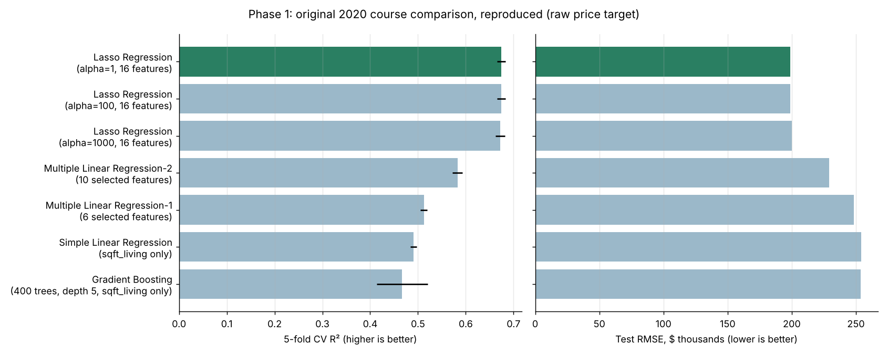</p>

### Phase 2: 2026 pipeline

Log-price target with metrics in dollars. The hold-out set is 4,323 sales (`random_state=42`). CV is 5 folds on the 17,290 training sales. "Inputs" is the number of columns the regressor sees, which is the *p* in adjusted R².

| Model | Inputs | Hold-out RMSE | Hold-out MAE | R² | Adj. R² | Median % error | Within 10% | CV RMSE (mean ± std) | CV R² (mean ± std) |
|---|---|---|---|---|---|---|---|---|---|
| Simple Linear Regression | 1 | $297,013 | $172,605 | 0.416 | 0.416 | 26.4% | 19.9% | $274,857 ± 18,175 | 0.419 ± 0.006 |
| Multiple Linear Regression | 91 | $136,807 | $74,129 | 0.876 | 0.874 | 9.5% | 52.5% | $120,571 ± 7,570 | 0.888 ± 0.007 |
| Ridge (alpha by CV) | 91 | $136,793 | $74,125 | 0.876 | 0.874 | 9.5% | 52.5% | $120,566 ± 7,570 | 0.888 ± 0.007 |
| Lasso (alpha by CV) | 91 | $136,786 | $74,122 | 0.876 | 0.874 | 9.5% | 52.5% | $120,552 ± 7,575 | 0.888 ± 0.007 |
| **Gradient Boosting** | 22 | **$113,376** | $62,475 | **0.915** | **0.915** | 8.0% | 58.7% | **$110,252 ± 7,866** | **0.906 ± 0.008** |
| HistGradientBoosting | 22 | $115,742 | $63,450 | 0.911 | 0.911 | 8.1% | 58.6% | $117,612 ± 14,400 | 0.894 ± 0.013 |
| XGBoost | 22 | $114,000 | **$61,858** | 0.914 | 0.914 | **7.8%** | **59.5%** | $112,587 ± 13,500 | 0.903 ± 0.013 |

**Winner: Gradient Boosting.** It has the lowest CV RMSE and the lowest hold-out RMSE, so it is the deployed model. XGBoost is a very close second and has slightly lower MAE and median error. **Lasso is the best linear model**, but only just: Multiple Linear Regression, Ridge and Lasso are within $21 of each other.

<p align="center">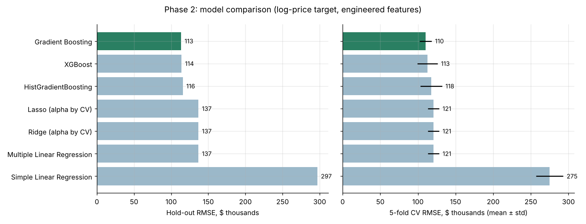</p>

<p align="center">
  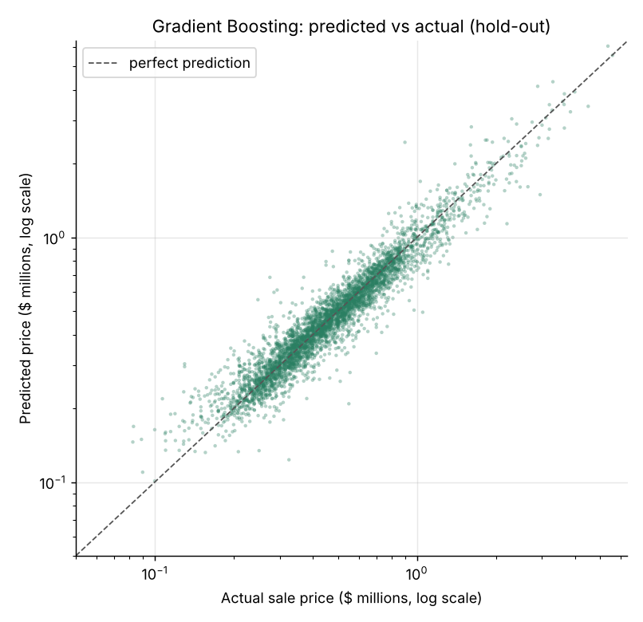
  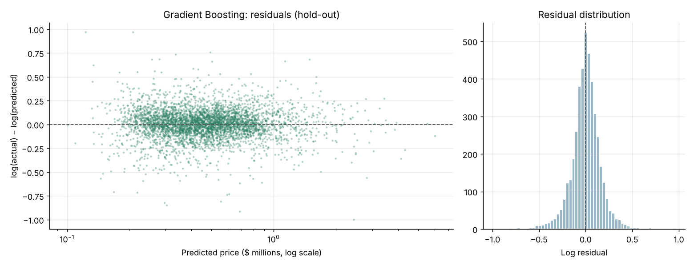
</p>

The residuals on the log scale are centred on zero and roughly symmetric, so the errors behave like a percentage. The spread is wider for the cheapest homes, where a $50,000 miss is a large share of the price.

### What drives price

<p align="center">
  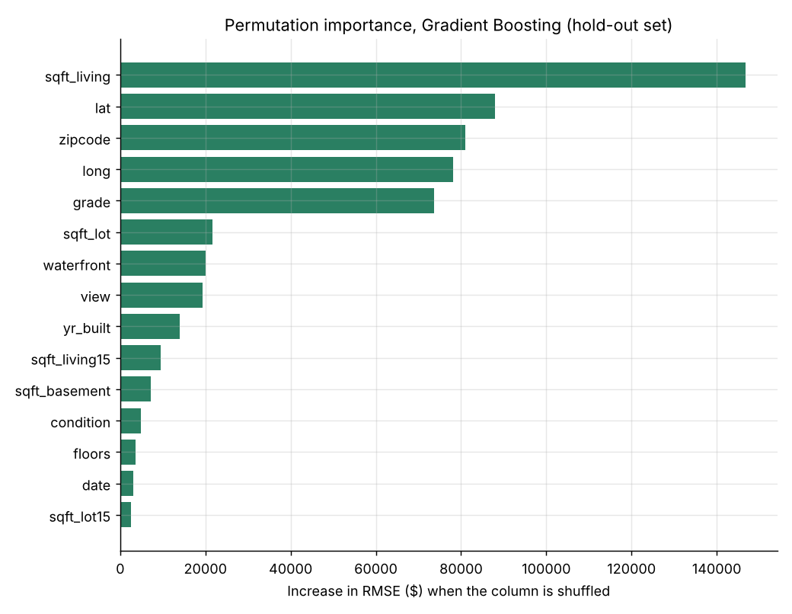
  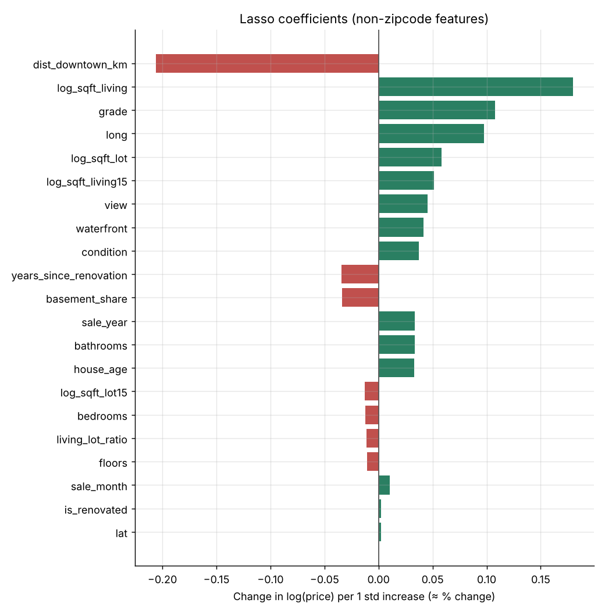
</p>

- **Gradient Boosting (left).** Shuffling `sqft_living` raises hold-out RMSE by about $147,000. Next come `lat` (+$88k), `zipcode` (+$81k), `long` (+$78k) and `grade` (+$74k). Location columns together outweigh everything except size.
- **Lasso (right).** These coefficients are on standardised inputs, so they read as the approximate % change in price per one standard deviation. `dist_downtown_km` has the largest effect (−0.21, about −19%), followed by `log_sqft_living` (+0.18) and `grade` (+0.11). On top of those, the 70 zipcode effects range from about +63 log points (98039, Medina) to −42 (98168). The full table is in [`lasso_coefficients.csv`](reports/metrics/lasso_coefficients.csv).

### Interactive demo

<p align="center">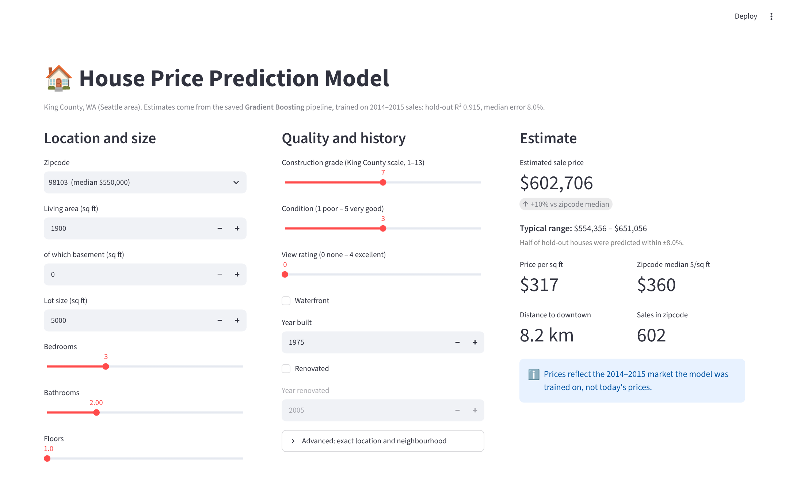</p>

Choose a zipcode and describe the house. The app returns the Gradient Boosting estimate, a typical range (± the model's median hold-out error of 8.0%), price per square foot against the zipcode median, and the distance to downtown.

---

## Key findings

1. **The original conclusion holds when reproduced.** Lasso Regression was the best of the four 2020 models on every metric (test R² 0.692, CV R² 0.674).
2. **But it won because of its features, not its penalty.** An unregularised linear regression on the same 16 features gives virtually the same test RMSE ($198,681 against $198,682), because on unscaled dollar-scale features an alpha of 1 to 1,000 barely shrinks anything. What separated the 2020 models was how much information they were given. The Gradient Boosting model, restricted to `sqft_living` alone, overfit (train R² 0.626, test R² 0.499).
3. **Better features and a better target matter more than a better algorithm.** Treating zipcode as a category, adding distance and age features, and modelling log-price lifts Lasso from R² 0.692 to 0.876. On its own split, Phase 2 Lasso's RMSE is 54% lower than a simple linear baseline.
4. **With a full feature set and log target, gradient boosting reduces hold-out RMSE by 17.1%** relative to Lasso ($136,786 → $113,376) and raises R² from 0.876 to 0.915. It captures interactions, such as a large house being worth far more in Medina than in Kent, that a linear model can only approximate.
5. **Lasso remains the most interpretable model.** It's within 0.04 R² of the best model, and every one of its coefficients can be read directly as a percentage effect. For explaining prices to a person, it's still the model to show.
6. **Location dominates.** Distance to downtown, zipcode and coordinates are among the top features for both model families, which matches the heat maps.

> **Comparing phases:** Phase 1 and Phase 2 use different random splits (`random_state=3` and `42`) and different targets, so their numbers are directionally comparable but not a paired test. Within each phase, every model is scored on the same split.

---

## 🧰 Tech stack

| Layer | Tools |
|---|---|
| Language | Python 3.10+ |
| Data | pandas, NumPy |
| Machine learning | scikit-learn (LinearRegression, LassoCV, RidgeCV, GradientBoostingRegressor, HistGradientBoostingRegressor, Pipeline, ColumnTransformer, OneHotEncoder, TargetEncoder, TransformedTargetRegressor, permutation importance), XGBoost |
| Visualisation | Matplotlib, Folium |
| Model persistence | joblib |
| Demo | Streamlit |
| Testing | pytest, `streamlit.testing.v1.AppTest` |
| Notebook | Jupyter / Google Colab |

## 🧠 Concepts demonstrated

- Reproducing an earlier analysis faithfully before improving it
- Linear, regularised (L1 / L2) and ensemble tree regression
- Feature engineering from dates and coordinates (haversine distance)
- Categorical encoding: one-hot and cross-fitted target encoding
- Leakage-free preprocessing with sklearn Pipelines refitted per CV fold
- Target transformation for a skewed target, with metrics reported on the original scale
- Model selection by cross-validation, with a hold-out set scored once
- Regression metrics: RMSE, MAE, R², adjusted R², median absolute % error
- Interpretability: regularised coefficients and permutation importance
- Geospatial visualisation: hexbin heat maps and interactive Folium maps

## Repository structure

```
house-price-prediction-model/
├── app/
│   └── streamlit_app.py            # interactive price estimator
├── data/
│   ├── kc_house_data.csv           # King County sales, 21,613 rows
│   ├── sample_houses.csv           # 12 hold-out houses for quick predictions
│   └── zipcode_profile.csv         # per-zipcode medians (app defaults, map labels)
├── docs/
│   └── report.pdf                  # original 2020 team report (PES University)
├── models/
│   └── house_price_model.joblib    # deployed Gradient Boosting pipeline
├── notebooks/
│   ├── house_price_walkthrough.ipynb       # run everything in Colab
│   └── original_2020_course_notebook.ipynb # the original notebook, kept for reference
├── reports/
│   ├── figures/                    # charts in this README + price_map.html
│   ├── metrics/                    # metrics.json, phase1/phase2 tables, coefficients, importance
│   └── screenshots/                # demo screenshot
├── src/
│   ├── config.py                   # paths, feature lists, seeds
│   ├── data_loader.py              # load the CSV (raw for Phase 1, typed for Phase 2)
│   ├── features.py                 # feature engineering, haversine distance
│   ├── models.py                   # preprocessing and the model zoo
│   ├── original_comparison.py      # Phase 1: 2020 comparison, reproduced
│   ├── train.py                    # Phase 2: CV, hold-out evaluation, figures, saving
│   ├── evaluate.py                 # metrics and charts
│   ├── geo.py                      # heat maps and Folium map
│   └── predict.py                  # price new houses from a CSV
├── tests/
│   ├── test_pipeline.py
│   └── test_app.py
├── pytest.ini
└── requirements.txt
```

## Getting started

**In the browser, no installation:** click **Open in Colab** at the top, then **Runtime > Run all**.

**Locally:**

```bash
git clone https://github.com/aish-19shanbhag/house-price-prediction-model.git
cd house-price-prediction-model
pip install -r requirements.txt

python -m src.original_comparison          # Phase 1 (~30 s)
python -m src.train                        # Phase 2: train, evaluate, write reports/ and models/ (a few minutes)
python -m src.predict data/sample_houses.csv
streamlit run app/streamlit_app.py         # interactive demo
pytest -q                                  # tests
```

## Limitations and next steps

- **The data is from 2014–2015.** Estimates reflect that market, not today's prices. Retraining on recent sales (for example, King County Assessor data) would be needed for real use.
- **Random splits ignore time.** A time-based split (train on earlier sales, test on later ones) would be a stricter test of forecasting.
- **No spatial cross-validation.** Neighbouring houses can land in both train and test sets. Grouping folds by area would give a more conservative estimate.
- **Hyperparameters are defaults.** A modest CV search for the boosted models could reduce error further, and an ensemble of Gradient Boosting and XGBoost is worth testing.
- **Uncertainty.** Quantile regression or conformal prediction would replace the app's median-error band with calibrated prediction intervals.
- **Serve it.** Next would be a REST endpoint and drift monitoring for production use.

## Team and credits

This began as an academic project at **PES University, Bengaluru (Aug 2020 to Dec 2020)**, by a team of four:

| Member | Contribution (from the [project report](docs/report.pdf)) |
|---|---|
| Navya Parameshwar Hegde | Lasso Regression, hypothesis testing, evaluation, final report |
| **Aishwarya Ramanath Shanbhag** | **Multiple Linear Regression, model evaluation, project conclusion, final report** |
| Richa Angadi | Simple Linear Regression, visualisation, evaluation, video |
| Atharva Nitin Moghe | Preprocessing, original README |

## Author

**Aishwarya Ramanath Shanbhag**, MS Computer Science, San José State University
[GitHub](https://github.com/aish-19shanbhag) · [LinkedIn](https://www.linkedin.com/in/aishwarya-ramanath-shanbhag-452255185/) · [Portfolio](https://aish-19shanbhag.github.io/)
